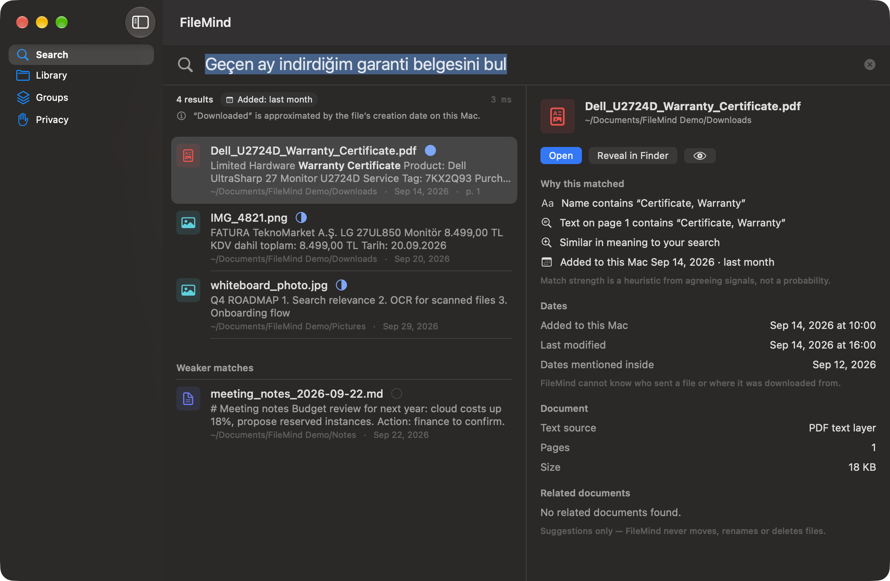

# FileMind

**Find files on your Mac by describing them — in English or Turkish.**
**Mac'indeki dosyaları adıyla değil, kendi cümlenle bul — Türkçe veya İngilizce.**

Free · On-device · No network access · Notarized by Apple

## Download / İndir

➡️ **[Download the latest version / En son sürümü indir](https://github.com/dagcann34/FileMind-releases/releases/latest)** (`FileMind-0.1.0.dmg`)

Requirements: macOS 15 or later. Universal app (Apple Silicon and Intel; tested on Apple Silicon).

Open the DMG and drag FileMind to Applications. / DMG'yi açın, FileMind'ı Uygulamalar klasörüne sürükleyin.

## What it does

- Natural-language search that understands dates: "the warranty certificate I downloaded last month", "elektrik faturası"
- Searches inside PDFs, text, Markdown and images; on-device OCR for scanned documents (Apple Vision)
- Hybrid search: keywords + a multilingual meaning model (multilingual-e5-small) running on your Mac
- Every result explains why it matched
- Suggests groups of related files — never moves, renames or deletes anything

Supported files: PDF, TXT, Markdown, PNG, JPEG, HEIC, TIFF. Word (DOCX) is not supported yet.

## Privacy

- No network entitlement, no telemetry, no analytics
- Reads only the folders you choose, read-only
- The search index stays on your Mac
- Full policy: [PRIVACY.md](PRIVACY.md)

## Honest status

Version 0.1.0 is an early release. On a synthetic set of 30 documents with 28 held-out queries, hybrid search reached
Recall@5 = 0.946. Real-world accuracy has not been measured yet — please tell us what it misses.

## Feedback / Geri bildirim

[Open an issue](https://github.com/dagcann34/FileMind-releases/issues) or e-mail dagcannural@hotmail.com.

---

FileMind is free to download and use. The source code is not published; all rights reserved.
Includes multilingual-e5-small (MIT License, Copyright (c) Microsoft Corporation) — see Acknowledgements inside the app.
